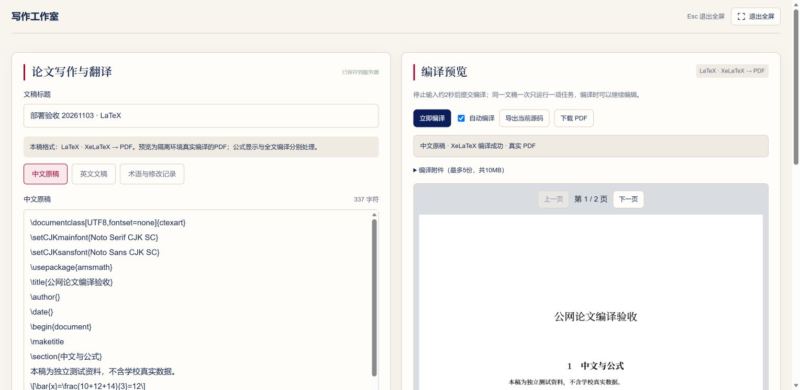

# 腾讯云更新与公网验收（2026-11-03）

访问地址：https://mathmodel.lingozm.cn:9443/ 。IP 备用地址：https://111.230.26.68:9443/ 。本轮没有修改域名解析、Nginx 或防火墙；不带端口的 443 地址本轮握手失败，不作为已验收入口。

## 运行版本与数据保护

- 新布局、对话/论文/写作区全屏、三种写作格式和真实 XeLaTeX 编译的代码版本为 `6c53107bf56480fa9bde15c8580e4e69002184f6`。
- 公网实测发现历史项目缺少更新时间时首页排序报错，修复为缺失日期回退到创建时间/空值；修复版本 `0635d420225669b163957209509266b81b03c80b` 已推送 GitHub。
- Web 镜像 `mathmodel-qa:layout-fullscreen-tex-20261103-h1`；后台任务服务沿用同一编译功能版本镜像，热修复仅修改三个前端 JS 文件。数据库、Redis 容器和原数据卷保留。
- 停止应用写入期间，备份 PostgreSQL、完整上传资料卷和私有部署配置；实际将数据库备份恢复到临时数据库，逐模型条数及内容摘要一致；候选应用只读核对原数据库也一致。
- 切换前的 27 个账号（学生19、教师5、固定管理员3）、78条业务记录、34份资料、20条聊天消息及45个已有资料文件均保留。注册策略、密码、模型/E2B/SMTP秘密配置未重置。
- 本轮独立测试新增三份文稿、一份合成论文与其原件、一条检索对话；之后为84条业务记录、35份资料。没有迁入本机另一套数据库或完整知识库，也没有重新初始化演示数据。

服务器备份位于 `/opt/mathmodel-ai-qa-20261024/private/layout-fullscreen-tex-20261103-6c53107/backup-20261103T065645`，仅在服务器私有目录保存，包含秘密配置的备份不得公开。

## 实际测试与证据

| 检查 | 实际结果 | 证据 |
|---|---|---|
| 腾讯云隔离回归 | PostgreSQL与独立Redis运行280项，失败0、错误0、跳过0；不挂载正式资料或发信/模型密钥 | `test_candidate-result.json` |
| 公网HTTPS与健康检查 | 域名9443、IP9443严格证书验证；数据库、Redis、调度器就绪 | `public-check-results.json` |
| 发布文件核对 | 新布局/编译模块及PDF.js与发布内容SHA256一致，3个热修复脚本与Git版本一致 | `public-check-results.json` |
| 现有账号（公网API） | 学生、教师、固定管理员的现有测试凭证均能经公网登录、加载各自工作空间；Secure/HttpOnly会话保留 | `public-check-results.json` |
| 私密路径 | 环境文件、访问凭证、部署配置、后端源码路径404；匿名工作空间403 | `public-check-results.json` |
| 学生页面 | Edge原有独立学生账号首页加载；缺日期项目可显示，新布局导航正常 | 本轮Edge实际操作 |
| LaTeX | Edge选择格式、新建、保存、自动编译、自定义中文及公式、两页PDF预览、翻页、全屏、Esc退出、刷新恢复 | `public-latex-fullscreen.png` |
| 真实执行/文件 | 腾讯云任务由E2B隔离环境真实编译；2页PDF 26,277字节；中文提取与第二页内容正确；资源已释放 | `public-pdf-results.json`、`public-compiled-paper.pdf` |
| 下载与权限 | 点击Edge下载后本地PDF与后端产物SHA256一致；匿名403、其他账号404 | `public-pdf-results.json` |
| Markdown | Edge实际创建，标题、公式、表格即时预览，HTML标签保持文本，脚本节点0，保存到后端 | 本轮Edge实际操作 |
| 普通文字 | Edge实际创建并保存，井号、HTML及数学标记按原样预览，不解析成HTML或公式 | 本轮Edge实际操作 |
| 对话 | Edge全屏与退出保留输入，实际保存问题并检索原文，生成真实检索对话记录；没有调用收费模型 | 本轮Edge实际操作 |
| 论文原件 | Edge实际上传合成PDF到腾讯云，进入论文详情；全屏与退出可用 | 本轮Edge实际操作 |
| 管理员端页面 | Edge实际登录原有固定管理账号，全平台总览及使用与成绩对照正常加载，统计表21行；检查后已退出测试账号 | `public-admin-analytics.png` |
| 教师端页面 | Edge实际登录原有教师测试账号，教学总览及学习监督中的授权学生、任务证据和历史监督计划正常加载 | `public-mentor-monitor.png` |
| 资源与回归状态 | 服务器可用内存约1.4GiB；无待迁移数据库结构、无排队/运行/待释放执行任务 | `postflight-result.json` |

## 限制与本轮未重复验收

- 当前Edge设置禁用了内置PDF阅读器，论文实验室使用浏览器原件预览时会提示下载。没有修改你的浏览器策略。写作编译预览使用独立PDF.js，实际能正常显示PDF。
- 全屏实际通过的是网页工作区展开及退出；不将浏览器原生Fullscreen API视为已单独验收。
- 本轮没有发送新的测试邮件，没有进行收费AI调用，也没有把既有配置可用写成新增送达/模型效果验收。
- 不带端口443、并发压测、MATLAB和商业求解器授权不属于本次发布通过项。
- 初次切换曾因部署检查的字符串/数值比较误触发应用回滚，原数据库和资料未回退；修复检查后完成发布。静态热修复第一次构建未通过，其间原应用继续运行，后续构建和上线成功。

## 回滚原则

保留原镜像与私有包装脚本。回滚时先停止入口和调度，等待代码/编译任务及待释放资源归零，再恢复应用文件和镜像；保留当前PostgreSQL、Redis、资料卷。不要执行 `down -v`、重新初始化账号或用旧备份覆盖新产生的用户资料。数据库和文件恢复是另外的灾难恢复操作，不是本次应用回滚的默认步骤。

公开仓库只附发布说明与合成论文截图；其余验证记录位于本机交付目录，私有备份和秘密配置不上传。

